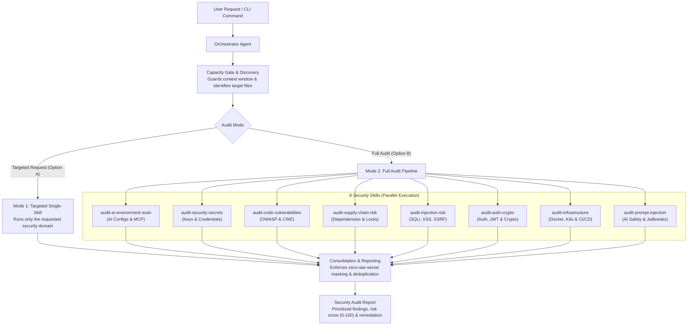

# General Security Plugin
This plugin is considered as package for security scanning general propose, the main usage, was to provide a ssecurity operational level for aplications code generated or manipulated by an AI Agent for coding.
As part of an code generation process, there are security checkpoints, that need to be evaluated in order to ensure the security of the generated code.

Ther context and reference, were considered combining OWASP Top 10 Aplication Risk, CWE, and OWASDP Top 10 AI Aplications Risks, for that reaon the sacning goals and apply in this pulging are focues on comun pattern identified in this references, realetd to AI coding vulnerabilities expusure.
The main goal is to provide a quick and efficient way, to identify, prevent and remediate this vulnerabilities, the plugin will suggest fixes including in code, base on best mitigation practice, but should not handle the fixes, instead is recomended to use dedicated tools which has this specific responsabilities.

But for specific context is recomended to use the specific security plugins for those contexts, for example for web security, use the web-security-plugin, for mobile security use the mobile-security-plugin, for cloud security use the cloud-security-plugin, and so on.

## INDEX
- [Architecture Overview](#architecture-overview)
- [Dependencies](#dependencies)
- [Installation and Setup](#installation-and-setup)
- [How to Use the plugin - Dual Execution Modes](#how-to-use-the-plugin-dual-execution-modes)
- [Hook Allocation and Enforcement](#hook-allocation-and-enforcement)
- [Invariant Rules](#invariant-rules)

---

## Architecture Overview

```text
general-security-plugin/
├── .agent-plugin/                              # plugin standard metadata
├── agents/                                     # orchestrator agent, security auditor
├── hooks/                                      # plugin hooks, components called by orchestrator agent
├── skills/                                     # 8 plugin skills, the different scanning  procedure and it's scripts
├── tests/                                      # plugin tests for hooks, and for skills script
├── .pyproject.toml/                            # dependencies for test execution   
└──settings-addition.json/                     # plugin settings reference, to add in your  custom agent or global agent settings
```



[BACK TO INDEX](#index)

---

## Dependencies

| Runtime          | Version       | Notes                          |
| ---------------- | ------------- | ------------------------------ |
| Python  (mandatory)         | >= 3.10       | Standard library only          |
| Development (optional)      | `pytest>=8.0.0`, `pytest-mock>=3.12.0`, `poethepoet>=0.25.0`, `ruff>=0.12.0` | Install with `pip install -e ".[dev]"` , you can find more info in [pyproject.toml](./pyproject.toml) |
---

## Installation and Setup

This plugin can be installed globally or locally, depending on the configuration and plugin-discovery mechanisms supported by your AI agent, such as the ones listed below:
*Some examples*
- `.agentic-system-name/.config/plugins/<add-plugin-here>`
- `agentic-system-name/plugin/<add-plugin-here>`
- `agentic-system-name/.config/plugins/marketplace/<add-plugin-here>`

**Note:** This project uses `git clone` instead of `npx`, consistent with the goal of building a security plugin for AI agents that is host-agent agnostic, transparent in its installation, and user-controlled.

### 1. Clone the repository

You can choose between global installation or project-local installation.
The paths mentioned below are examples, not universal standards. Check your agent's documentation before choosing an installation location.

|Installation Type|Description|Example|
|-------------------|-------------|-------|
|Global installation|Clone the repository into a directory supported by your agent's plugin configuration, custom plugin directory, or local marketplace location, as mentioned above.|`.agentic-system-name/.config/plugins/git clone <repository-url>`|
|Project-local installation|Clone the repository into the project's supported plugin directory if your agent supports this convention.|`my-project/.agent/plugins/git clone <repository-url>`|

### 2. Check the runtime prerequisites
The hook requires Python 3.10 or later and uses only the Python standard library.
Check your installed version:

```bash
python3 --version
```
If Python is missing or the installed version is incompatible, install a supported version before enabling the hook. 

### 3. Configure the plugin

Add the plugin to the appropriate agent settings file and enable it according to the configuration format supported by your agent. You can use the snippet in [settings-addition.json](./settings-addition.json) and add it to your agent configuration settings file.

Configure the `PreToolUse` hook to invoke `capacity_gate_hook.py` using a valid path to the cloned repository.

Ensure that:

* The plugin identifier matches the metadata and settings configuration.
* The configured command resolves the correct Python interpreter and hook file.
* The hook is registered only once in the effective configuration.
* The selected tools and event matchers are supported by your agent.

Refer to your agent's documentation for the exact settings location, hook syntax, and activation procedure.

### 4. Verify the installation

After enabling the plugin:

[x] Confirm that Python meets the minimum version requirement.
[x] Check that the hook file exists at the configured path.
[x] Verify that the agent recognizes the hook configuration.
[x] Perform a functional check using the documented hook behavior.

Do not assume that a successful repository clone means the hook is active.

[BACK TO INDEX](#index)

## How to Use the plugin - Dual Execution Modes

Currently the  [orchestrator-general-security](./agents/orchestrator-general-security.md)  is the sub-agent, which operates as a plugin orchestrator, so it trigger specific skills or the full audit pipeline, this method is designed to eliminate unnecessary token ingestion. 

Below you can check the 2 modes, always needs to be **Enabled:True** the plugin and you should **provide the path to the target scan**, prefer use **absolute path** to avoid any issue with the hook execution or plugin discovery:

### Mode 1: Targeted Single-Skill Execution (Token & Time Efficient)
When the user's intent maps to a narrow task, *User* propmt example:

```txt
Use /general-security-plugin to check if `.env` has leaked secrets in <absolute/path/to/project/>
```
```txt
Use /general-security-plugin to run a regex for AWS keys in /src directory <absolute/path/to/project/>
```
```txt
Use /general-security-plugin to scan only SQL injection in routes/" in <absolute/path/to/project/>
```

In this case the  sub-agent identifies the specific matcher and can prompt the user with an informative decision:
* **Option A (Targeted Execution):** Runs ONLY `<specific-selected-skill>` with targeted arguments (e.g. `audit-security-secrets` on `.env`), skipping all other stages and saving thousands of tokens.
* **Option B (Comprehensive Audit):** Runs the full audit across the entire workspace.

- First, the orchestrator-agent execute the `hooks/capacity_gate_hook.py` with the <absolute/path/to/project/> target.
- Then execute the specific skill with the <absolute/path/to/project/> target.

[BACK TO INDEX](#index)

### Mode 2: Full End-to-End Audit Pipeline
When a broad audit is requested or selected for the *User* prompt, for example:

```txt
Use /general-security-plugin to run a full check for this project <absolute/path/to/project/>
```
```txt
Use /general-security-plugin to Audit my repo for leaks beforee deployment <absolute/path/to/project/>
```
```txt
/general-security-plugin is this project secure for deployment? <absolute/path/to/project/>
```

- First, the orchestrator-agent execute the `hooks/capacity_gate_hook.py` with the <absolute/path/to/project/> target.
- Then execute parallelly in background all the 8 skills with the <absolute/path/to/project/> target.

|#|Skill| Scanning Targets|
|---|---|---|
|1|**audit-ai-environment-scan**|Audit AGENTS.md, hooks, MCP config, permissions, CLAUDE.md, .cursorrules|
|2|**audit-security-secrets**|Scan for hardcoded API keys, credentials, .env files, private keys|
|3|**audit-code-vulnerabilities**|Check OWASP Top 10, CWEs, AI-specific vulnerability patterns|
|4|**audit-supply-chain-risk**|Audit dependencies, lockfiles, version pinning, typosquatting|
|5|**audit-injection-risk**|Detect SQLi, XSS, command injection, SSRF, path traversal|
|6|**audit-auth-crypto**|Review authentication, JWT, crypto, sessions, access control|
|7|**audit-infrastructure**|Audit Docker, K8s, CI/CD pipelines, Terraform, cloud config|
|8|**audit-prompt-injection**|Detect hidden instructions, unicode attacks, encoded payloads|


>[!NOTE]
>If you already use and `AGENT.md` file or othere work memory for your agents you can indicated the registry acces to the plugin path, or you can enable it in your markek place to use it automaticaly full audit mode.

>[!NOTE]
> Test the plugin before use it, add some credentiasl or hardcode strings in your codebase to verify it works as expected. For example: `OPENAI_API_KEY=sk-1234567890` or `DB_PASSWORD=admin123`. Test the plugin as muts you need, preserve the *Zero Trust* Principle, it means constant verification and auditable evidence over trust in the code or in ourself. This principle is the foundation of the secure systems.

[BACK TO INDEX](#index)

## Hook Allocation and Enforcement
This project use a PreToolUse hook to gate the tool usage, it intercept the tool calls `view_file|read_file|grep_search` before execution. 
The goal is to make the tool call deterministic and efficient, while prevent the usage of large files from the context window and reduce the token consumption, also prioritize the relevant files for the scan considering patterns and risk tier,prioritizing the high risk files first.

**The `hook` can be invoked in 2 forms:**
- By adding it within an existing `agent.setting.json` or `agent.setting.yaml` file (thi was explained in the section **3. Configure the plugin** )
- By adding `hook: python3 hooks/capacity_gate_hook.py` to the agent's YAML frontmatter metadata.

Currently project already include the both forms, so you can select the desired form to use it, as your agent custom workflow preference (also this could be change in the mode that you setup the plugin, if is local or global use).

**Current project `hooks` allocation:**

- **PreToolUse Allocation:** The hook is allocated in [`settings-addition.json`](settings-addition.json).
- **Agent Metadata Enforcement:** The hook is allocated in [`agents/orchestrator-general-security.md`](agents/orchestrator-general-security.md) as part of the YAML frontmatter metadata (`hook: python3 hooks/capacity_gate_hook.py`) to enforce capacity gating on agent operations.

[BACK TO INDEX](#index)

---

## Invariant Rules
1. **Strictly Non-Destructive:** No files are created, edited, deleted, or committed in the scanned workspace.
2. **Zero Network Egress:** No remote endpoints or APIs are contacted. Secrets are never tested live.
3. **Evidence Masking Invariant:** Raw secrets are NEVER outputted to logs, terminal, or final reports. All keys are masked (e.g., `AKIA************7E2A`).

### Development and Testing

Development dependencies are optional and are not required to use the plugin.

If you want to run tests or contribute to the project, follow the testing instructions in [Testing Strategy](./tests/README.md) and review `pyproject.toml`.

[BACK TO INDEX](#index)

[!IMPORTANT]
>This project use deterministic features in some parts to combine regex logical detection with other engines and LLM classification for a more effective detection. You can fine some of them as a couplin monolithic, this was intentional, because each of them were considered as unique tool, now as a complete src deterministic aplication, but if you consider a better aproach you can modularize it as much as you want. 

## License
Copyright 2026 Leticia Perez Gainza. Licensed under the Apache License 2.0.
See [LICENSE](./LICENSE) for details.

[BACK TO INDEX](#index)

